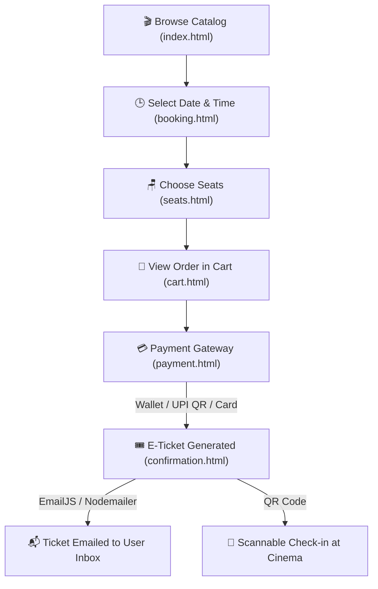

# 🎬 CineBook — Modern Cinema Booking Web Application

[](#)
[](#)
[](#)
[](#)
[](#)
[](#)

> **"YOUR MOVIE. YOUR SEAT. YOUR EXPERIENCE."**  
> A feature-rich, cinema ticket reservation web application inspired by BookMyShow. CineBook features interactive tiered seat selection, digital wallet checkout, automated E-Ticket generation with scannable QR codes, instant ticket cancellation with refund routing, and an admin management portal.

---

## 📸 Preview


---

## 🌟 Highlights & Key Features

### 🎟️ 1. Interactive Cinema Seating Engine
* **BookMyShow-Style Tiered Layout:** Distinct pricing and comfort tiers from **A through K**:
  * 👑 **Recliner Rows** (₹280)
  * ⭐ **Prime Rows** (₹170)
  * 🦵 **Extra Legroom** (₹200)
  * 🍿 **Classic Plus** (₹150)
  * 🎟️ **Classic** (₹105)
* **Real-time Price Engine:** Dynamically calculates total price, taxes, and selected seats count.
* **Smart Seat States:** Real-time visual feedback for `Available`, `Selected`, and `Occupied` seats.
* **Cinematic Best Seats Glow:** Premium center seats feature a subtle pulsing glow for the ultimate viewing experience.

### 💳 2. Digital CineBook Wallet & Multi-Method Checkout
* **In-App Digital Wallet:** Dedicated wallet system with persistent balance displayed directly in the navbar header.
* **Wallet Top-Up:** Instant deposit interface with real-time balance refresh.
* **Flexible Checkout Options:**
  * 📲 **Dynamic Mock UPI:** Generates a real-time scannable QR code via QuickChart API.
  * 💳 **Debit / Credit Card & Net Banking:** Simulated payment gateway with validation.
  * 👛 **CineBook Wallet:** Deducts tickets instantly from your current wallet balance.

### 📩 3. Automated E-Tickets with Scannable QR Codes
* **Instant E-Ticket Generator:** Creates a movie pass featuring unique Booking ID (e.g. `CB123456`), screening details, seat numbers, and theater info.
* **Live Scannable QR Code:** Generated dynamically using the **QuickChart API**.
* **Automated Email Dispatch:** Seamless integration with **EmailJS** (client-side) and **Nodemailer / Express** (server-side) to send digital tickets straight to the user's inbox.

### 🔄 4. Booking Management & Instant Cancellation
* **My Bookings / Cart:** Centralized hub to view active and past reservations.
* **Cancellation & Refund Routing:** Cancel confirmed bookings with flexible refund choices:
  * ⚡ **Instant Refund:** Automatically credits funds back to the user's **CineBook Wallet**.
  * 🏦 **Bank Transfer:** Simulated 24-hour return to the originating payment account.

### 🛠️ 5. Admin Portal (`admin.html`)
* **Movie Catalog Management:** Add new movies, set genres, update showtimes, posters, and category classifications (**Now Showing**, **Upcoming**, **Coming Soon**).
* **Global Bookings Viewer:** Inspect bookings placed across all user accounts in real time.

### 💾 6. Lightweight Zero-DB Architecture
* Built to run smoothly and free on platforms like **GitHub Pages** or **Render** without requiring a database setup like MongoDB or PostgreSQL.
* Leverages browser `localStorage` as a fast client-side database for sessions, movies, wallet balance, and ticket records.

---

## 🛠️ Tech Stack & Architecture

| Layer | Technologies / APIs |
|---|---|
| **Frontend** | HTML5, CSS3 (Modern Flexbox & CSS Grid), Vanilla JavaScript (ES6+) |
| **Typography & Icons** | Google Fonts (*Poppins*), Custom SVG Icons |
| **Storage / Database** | Browser `localStorage` (Session, Wallet, Cart, Bookings, Added Movies) |
| **Backend (Optional / Local)** | Node.js, Express 5.x |
| **Email Services** | **EmailJS** (Direct browser email dispatch) & **Nodemailer** (Server-side) |
| **QR Code Engine** | **QuickChart API** (Live dynamic QR rendering) |

---

## 📂 Project Structure

```text
CINEMA BOOKING WEBSITE/
│
├── images/                         # Posters, QR assets, screenshots, banners
│   ├── home.png                    # Home page banner / screenshot
│   ├── scene.jpg                   # Hero background imagery
│   └── ...                         # Movie posters
│
├── index.html                      # Homepage: Movie showcase, trailer popups, navigation
├── booking.html                    # Movie & showtime selection page
├── seats.html                      # Tiered seat selection layout & pricing engine
├── cart.html                       # User cart, active tickets, and cancellation manager
├── payment.html                    # Checkout gateway (UPI QR, Card, Net Banking, Wallet)
├── confirmation.html               # Booking confirmation and E-Ticket display
├── login.html                      # User sign in / registration
├── wallet.html                     # CineBook digital wallet dashboard
├── admin.html                      # Admin dashboard: Add movies & view global bookings
│
├── script.js                       # Core application logic & localStorage manager
├── style.css                       # Global styles, dark theme, animations & responsive layout
├── server.js                       # Optional Node.js + Express backend with Nodemailer
│
├── package.json                    # Project metadata & npm dependencies
├── package-lock.json               # Locked dependency tree
├── .env.example                    # Environment variable template
└── README.md                       # Project documentation
```

---

## 🚀 Getting Started

You can run CineBook in two ways:
1. **Frontend Only (Static Mode)** — No Node.js required; can be opened directly or hosted on GitHub Pages.
2. **Full-Stack Mode (Node.js + Express)** — Enables server-side static serving and Nodemailer email dispatch.

### Option A: Running Directly (Frontend Only)
1. Clone this repository:
   ```bash
   git clone https://github.com/unforeseenallen/cinebook.git
   cd cinebook
   ```
2. Double-click or open `index.html` in any modern web browser (or use the VS Code **Live Server** extension).

---

### Option B: Running with Node.js & Express

1. **Clone the repository:**
   ```bash
   git clone https://github.com/unforeseenallen/cinebook.git
   cd cinebook
   ```

2. **Install dependencies:**
   ```bash
   npm install
   ```

3. **Configure Environment Variables:**
   Create a `.env` file in the root directory (refer to `.env.example`):
   ```env
   PORT=3000
   EMAIL_USER=your-email@gmail.com
   EMAIL_PASS=your-google-app-password
   ```
   > 💡 *Note:* If using Gmail, use a 16-character **App Password** generated from your Google Account security settings.

4. **Start the server:**
   ```bash
   npm start
   ```

5. **Open in your browser:**
   ```
   http://localhost:3000
   ```

---

## 🔄 User Journey & Data Flow



---

## 🛡️ Admin Portal Guide

1. Navigate to `/admin.html` in your browser.
2. Add new movie entries:
   * **Title, Genre, Description, Trailer URL**
   * **Category:** Choose between *Now Showing*, *Upcoming*, or *Coming Soon*
   * **Showtimes:** Define custom time slots (e.g., `10:00 AM`, `02:30 PM`, `07:00 PM`)
3. View the **Global Bookings** table to audit all customer transactions and reserved seats.

---

## 🤝 Contributing

Contributions, issues, and feature requests are welcome!
1. Fork the Project
2. Create your Feature Branch (`git checkout -b feature/AmazingFeature`)
3. Commit your Changes (`git commit -m 'Add some AmazingFeature'`)
4. Push to the Branch (`git push origin feature/AmazingFeature`)
5. Open a Pull Request

---

## 📄 License

This project is licensed under the [MIT License](LICENSE).

---

<p align="center">
  Crafted with ❤️ for cinema lovers.
</p>
